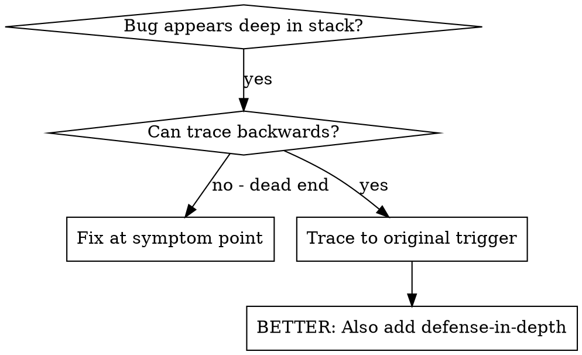
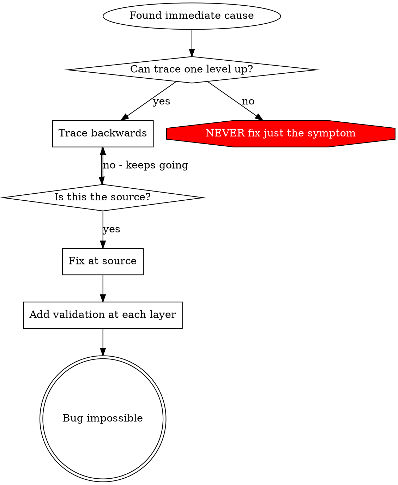

# Root Cause Tracing

## Overview

Bugs often manifest deep in the call stack (git init in wrong directory, file created in wrong location, database opened with wrong path). Your instinct is to fix where the error appears, but that's treating a symptom.

**Core principle:** Trace backward through the call chain until you find the original trigger, then fix at the source.

## When to Use



**Use when:**
- Error happens deep in execution (not at entry point)
- Stack trace shows long call chain
- Unclear where invalid data originated
- Need to find which test/code triggers the problem

## The Tracing Process

### 1. Observe the Symptom
```
Error: git init failed in ~/project/packages/core
```

### 2. Find Immediate Cause
**What code directly causes this?**
```typescript
await execFileAsync('git', ['init'], { cwd: projectDir });
```

### 3. Ask: What Called This?
```typescript
WorktreeManager.createSessionWorktree(projectDir, sessionId)
  → called by Session.initializeWorkspace()
  → called by Session.create()
  → called by test at Project.create()
```

### 4. Keep Tracing Up
**What value was passed?**
- `projectDir = ''` (empty string!)
- Empty string as `cwd` resolves to `process.cwd()`
- That's the source code directory!

### 5. Find Original Trigger
**Where did empty string come from?**
```typescript
const context = setupCoreTest(); // Returns { tempDir: '' }
Project.create('name', context.tempDir); // Accessed before beforeEach!
```

## Adding Stack Traces

When you can't trace manually, add instrumentation:

```typescript
// Before the problematic operation
async function gitInit(directory: string) {
  const stack = new Error().stack;
  console.error('DEBUG git init:', {
    directory,
    cwd: process.cwd(),
    nodeEnv: process.env.NODE_ENV,
    stack,
  });

  await execFileAsync('git', ['init'], { cwd: directory });
}
```

**Critical:** Use `console.error()` in tests (not logger - may not show)

**Run and capture:**
```bash
npm test 2>&1 | grep 'DEBUG git init'
```

**Analyze stack traces:**
- Look for test file names
- Find the line number triggering the call
- Identify the pattern (same test? same parameter?)

## Finding Which Test Causes Pollution

If something appears during tests but you don't know which test:

Use the bisection script (inlined below — the standalone `find-polluter.sh`
was folded into this doc on 2026-11-20, GEN-2 format hygiene):

```bash
./find-polluter.sh '.git' 'src/**/*.test.ts'
```

Runs tests one-by-one, stops at first polluter. Full script:

```bash
#!/usr/bin/env bash
# Bisection script to find which test creates unwanted files/state
# Usage: ./find-polluter.sh <file_or_dir_to_check> <test_pattern>
# Example: ./find-polluter.sh '.git' 'src/**/*.test.ts'

set -e

if [ $# -ne 2 ]; then
  echo "Usage: $0 <file_to_check> <test_pattern>"
  echo "Example: $0 '.git' 'src/**/*.test.ts'"
  exit 1
fi

POLLUTION_CHECK="$1"
TEST_PATTERN="$2"

echo "🔍 Searching for test that creates: $POLLUTION_CHECK"
echo "Test pattern: $TEST_PATTERN"
echo ""

# Get list of test files (find . emits ./-prefixed paths, so accept the
# pattern written with or without a leading ./)
TEST_PATTERN="${TEST_PATTERN#./}"
# find -path can't match '**/' against zero directory levels, so a pattern
# like src/**/*.test.ts would skip src/top.test.ts; also try the pattern
# with '**/' collapsed to cover files directly under the base directory.
TEST_FILES=$(find . \( -path "./$TEST_PATTERN" -o -path "./${TEST_PATTERN//\*\*\//}" \) | sort -u)
if [ -z "$TEST_FILES" ]; then
  TOTAL=0
else
  TOTAL=$(printf '%s\n' "$TEST_FILES" | wc -l | tr -d ' ')
fi

echo "Found $TOTAL test files"
echo ""

COUNT=0
for TEST_FILE in $TEST_FILES; do
  COUNT=$((COUNT + 1))

  # Skip if pollution already exists
  if [ -e "$POLLUTION_CHECK" ]; then
    echo "⚠️  Pollution already exists before test $COUNT/$TOTAL"
    echo "   Skipping: $TEST_FILE"
    continue
  fi

  echo "[$COUNT/$TOTAL] Testing: $TEST_FILE"

  # Run the test
  npm test "$TEST_FILE" > /dev/null 2>&1 || true

  # Check if pollution appeared
  if [ -e "$POLLUTION_CHECK" ]; then
    echo ""
    echo "🎯 FOUND POLLUTER!"
    echo "   Test: $TEST_FILE"
    echo "   Created: $POLLUTION_CHECK"
    echo ""
    echo "Pollution details:"
    ls -la "$POLLUTION_CHECK"
    echo ""
    echo "To investigate:"
    echo "  npm test $TEST_FILE    # Run just this test"
    echo "  cat $TEST_FILE         # Review test code"
    exit 1
  fi
done

echo ""
echo "✅ No polluter found - all tests clean!"
exit 0
```

## Real Example: Empty projectDir

**Symptom:** `.git` created in `packages/core/` (source code)

**Trace chain:**
1. `git init` runs in `process.cwd()` ← empty cwd parameter
2. WorktreeManager called with empty projectDir
3. Session.create() passed empty string
4. Test accessed `context.tempDir` before beforeEach
5. setupCoreTest() returns `{ tempDir: '' }` initially

**Root cause:** Top-level variable initialization accessing empty value

**Fix:** Made tempDir a getter that throws if accessed before beforeEach

**Also added defense-in-depth:**
- Layer 1: Project.create() validates directory
- Layer 2: WorkspaceManager validates not empty
- Layer 3: NODE_ENV guard refuses git init outside tmpdir
- Layer 4: Stack trace logging before git init

## Key Principle



**NEVER fix just where the error appears.** Trace back to find the original trigger.

## Stack Trace Tips

**In tests:** Use `console.error()` not logger - logger may be suppressed
**Before operation:** Log before the dangerous operation, not after it fails
**Include context:** Directory, cwd, environment variables, timestamps
**Capture stack:** `new Error().stack` shows complete call chain

## Real-World Impact

From debugging session (2025-10-03):
- Found root cause through 5-level trace
- Fixed at source (getter validation)
- Added 4 layers of defense
- 1847 tests passed, zero pollution
